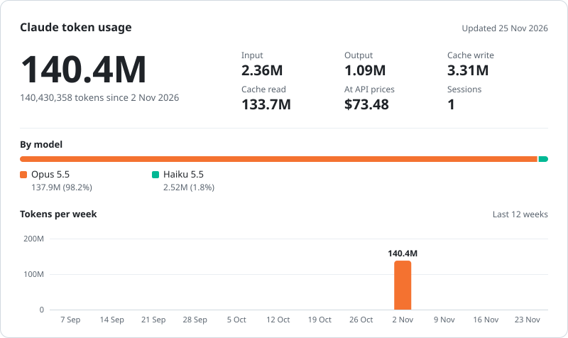

# mer-claude-ting

ting for claude

## My Claude token usage

<picture>
  <source media="(prefers-color-scheme: dark)" srcset="cards/usage-dark.svg">
  <source media="(prefers-color-scheme: light)" srcset="cards/usage-light.svg">
  
</picture>

<!-- usage:start -->
| Model | Input | Output | Cache write | Cache read | Total | At API prices |
|---|---:|---:|---:|---:|---:|---:|
| Opus 5.5 | 12,669 | 920,331 | 3,307,900 | 133,665,678 | 137,906,578 | $71.65 |
| Haiku 5.5 | 2,351,376 | 172,404 | 0 | 0 | 2,523,780 | $1.83 |
| **All models** | **2,364,045** | **1,092,735** | **3,307,900** | **133,665,678** | **140,430,358** | **$73.48** |

| Week starting | Tokens |
|---|---:|
| 2 Nov 2026 | 140,430,358 |

Updated 25 Nov 2026 from 1 session.
<!-- usage:end -->

### What the numbers mean

- **Input** and **output** are the tokens sent to and written by Claude.
- **Cache write** and **cache read** are context stored in and re-read from the prompt cache. Every step of a long session re-reads its whole context, so cache reads make up most of the total.
- **At API prices** is what the same usage would cost at Anthropic's list prices for the API. It is not what a subscription costs.
- Weeks start on Monday, Norwegian time.

### How it updates

Each Claude Code session on claude.ai records exact token counts per model whenever a turn finishes. A Claude session copies those counts into `usage/snapshots.jsonl` and runs `node scripts/build.mjs`, which draws the cards and fills in the tables above. Only numbers are stored here, never conversation text. The steps are in [CLAUDE.md](CLAUDE.md).

### Use it somewhere else

Paste this into any README, for example your profile README, to show a small badge:

```markdown

```
