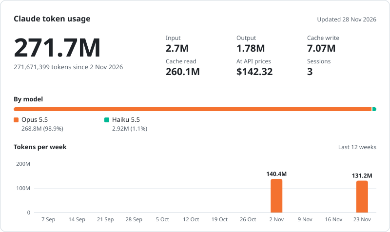

# mer-claude-ting

ting for claude

## My Claude token usage

<picture>
  <source media="(prefers-color-scheme: dark)" srcset="cards/usage-dark-9c864a5f4d.svg">
  <source media="(prefers-color-scheme: light)" srcset="cards/usage-light-9c864a5f4d.svg">
  
</picture>

<!-- usage:start -->
| Model | Input | Output | Cache write | Cache read | Total | At API prices |
|---|---:|---:|---:|---:|---:|---:|
| Opus 5.5 | 28,481 | 1,583,657 | 7,051,470 | 260,089,597 | 268,753,205 | $140.22 |
| Haiku 5.5 | 2,671,162 | 197,317 | 16,697 | 33,018 | 2,918,194 | $2.10 |
| **All models** | **2,699,643** | **1,780,974** | **7,068,167** | **260,122,615** | **271,671,399** | **$142.32** |

| Week starting | Tokens |
|---|---:|
| 23 Nov 2026 | 131,241,041 |
| 2 Nov 2026 | 140,430,358 |

Updated 28 Nov 2026 from 3 sessions.
<!-- usage:end -->

### What the numbers mean

- **Input** and **output** are the tokens sent to and written by Claude.
- **Cache write** and **cache read** are context stored in and re-read from the prompt cache. Every step of a long session re-reads its whole context, so cache reads make up most of the total.
- **At API prices** is what the same usage would cost at Anthropic's list prices for the API. It is not what a subscription costs.
- **Not split by model**, when it shows up, is usage from a turn that was still running at the last update. The next update moves it to the right model.
- Weeks start on Monday, Norwegian time.

### How it updates

Each Claude Code session on claude.ai keeps a running count of its tokens, and records them per model whenever a turn finishes. To refresh the card, open a Claude session with this repo and say "update my token usage". It copies those counts into `usage/snapshots.jsonl` and runs `node scripts/build.mjs`, which draws the cards and fills in the tables above. Only numbers are stored here, never conversation text. The steps are in [CLAUDE.md](CLAUDE.md).

### Use it somewhere else

Paste this into any README, for example your profile README, to show a small badge:

```markdown

```
